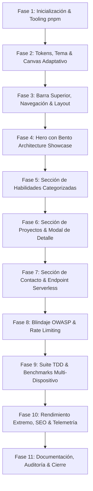

# 🚀 Documento de Planificación Integral Re-Arquitecturado: Portafolio Profesional Full-Stack Developer
## 💻 Paradigma de Diseño: "CodeCraft UI — Minimalismo Tecnológico & Alta Conversión"
## ⚡ Estrategia de Optimización Web Extrema & Fluidez Multi-Dispositivo (Omni-Device Performance)

---

## 📋 1. Ficha Técnica del Proyecto

* **Nombre del Proyecto:** Portafolio Profesional de Desarrollador Full-Stack (CodeCraft Digital Experience)
* **Rol / Perfil del Propietario:** Desarrollador Web Full-Stack & Ingeniero de Software
* **Identidad Visual & Paradigma de Diseño:** **"CodeCraft UI — Sencillo, Atractivo y Profesional"**
  * Una identidad estética inspirada en el desarrollo de software y la ingeniería moderna, pero concebida bajo criterios estrictos de **usabilidad, claridad y conversión**. 
  * Se evitan imitaciones de terminales crípticas o comandos que puedan desorientar a reclutadores o clientes. En su lugar, se adoptan tarjetas Bento limpias, tipografía contemporánea con acentos monoespaciados, microinteracciones fluidas y un canvas ambiental cinemático que comunica sofisticación técnica y madurez profesional.
* **Compromiso de Rendimiento Multi-Dispositivo:**
  * **Omni-Device Fluidity Guarantee:** El software está concebido desde su arquitectura base para operar a **60/120 FPS estables en cualquier pantalla**, desde smartphones económicos de gama de entrada con procesadores limitados y conexiones móviles 3G/4G, hasta monitores Ultrawide de alta tasa de refresco (144Hz+).
  * Implementación de un **Motor de Fidelidad Adaptativa (Adaptive Fidelity Engine)** que calibra automáticamente efectos visuales, conteo de partículas, desenfoques (`backdrop-blur`) y físicas según la memoria del dispositivo (`deviceMemory`), concurrencia de núcleos CPU (`hardwareConcurrency`), estado de batería y calidad de conexión.
* **Referencias de Diseño Integradas y Sinergia:**
  1. **[sawad.framer.website](https://sawad.framer.website/) (Estructura, Claridad & Bento Grid):**
     * Arquitectura de rejilla Bento ultra-limpia y espaciada con precisión.
     * Alto contraste cromático con superficies oscuras depuradas (obsidiana y grafito), acentos de color vibrantes dosificados (*Cyber Lime* y *Syntax Amber*) y micro-bordes elegantes.
     * Jerarquía visual intuitiva que permite al visitante entender el perfil, habilidades y proyectos en segundos sin barreras cognitivas.
  2. **[abhishekganvir.vercel.app](https://abhishekganvir.vercel.app/) (Presentación de Habilidades & Proyectos):**
     * Desglose de proyectos con métricas de impacto reales, retos resueltos y enlaces directos a Live Demo y Repositorio en GitHub.
     * Badges tecnológicos visualmente atractivos con iconos vectoriales oficiales y etiquetas de versión.
     * Transiciones escalonadas (*staggered animations*) que transmiten fluidez y modernidad.
  3. **[activetheory.net](https://activetheory.net/) (Atmósfera Tecnológica & Microinteracciones Cinemáticas):**
     * Canvas ambiental interactivo de partículas geométricas o malla fluida que reacciona sutilmente al cursor del mouse sin interferir con la legibilidad ni penalizar el rendimiento.
     * Tipografía arquitectónica cuidada (kerning óptico, espaciados precisos, combinación equilibrada entre Sans-Serif y Monospace).
     * Transiciones suaves con física de resortes (*spring physics*) y micro-líneas estructurales que transmiten el nivel de un estudio digital de clase mundial.
* **Naturaleza del Software:** Single-Page Application (SPA) con Server-Side Rendering (SSR) y Static Site Generation (SSG) sobre arquitectura Jamstack en Next.js. 100% libre de base de datos relacional/NoSQL en favor de tipado estricto Data-as-Code.
* **Framework Principal:** [Next.js](https://nextjs.org/) (versión 15+ con App Router y React 19).
* **Gestor de Paquetes Exclusivo:** `pnpm` (versión 10+ con política de bloqueo estricta `engineStrict`).
* **Lenguaje:** TypeScript 5+ (Strict Mode activo, sin `any`, validación estricta de nulos).
* **Motor de Estilos:** Tailwind CSS (con tokens semánticos de diseño y arquitectura de temas CSS variables).
* **Gestión de Tema:** `next-themes` (Soporte dual: modo **Code Dark** [predeterminado] y modo **Studio Light**, sin FOUC ni parpadeo).
* **Motor de Animaciones:** Framer Motion (orquestación staggered, animaciones de entrada, layout animations suaves y soporte para `prefers-reduced-motion`).
* **Validación de Formularios:** React Hook Form + Zod (esquema compartido cliente/servidor).
* **Seguridad y Rate Limiting:** Rate Limiting en memoria / Token Bucket (3 envíos por IP / 15 min) + Campo Honeypot silencioso + Cabeceras de seguridad estrictas (CSP, HSTS).
* **Metodología de Desarrollo:** Test-Driven Development (TDD) — Ciclo Red-Green-Refactor con Vitest, React Testing Library y Playwright.
* **Calidad de Código:** Clean Code + Principios SOLID aplicados a React + Comentarios contextuales y TSDoc/JSDoc en cada módulo.

---

## 🎨 2. Especificación del Sistema de Diseño "CodeCraft UI"

```
┌────────────────────────────────────────────────────────────────────────────────────────┐
│ [●] alirio.dev      01.inicio   02.sobre-mi   03.habilidades   04.proyectos   [Contact]│
├────────────────────────────────────────────────────────────────────────────────────────┤
│                                                                                        │
│   ● DISPONIBLE PARA PROYECTOS · ZONA HORARIA UTC-4                                     │
│   Construyo software de producción con                                                 │
│   arquitectura limpia y experiencia fluida.                                            │
│                                                                                        │
│   [ Explorar Proyectos → ]     [ Descargar CV ]                                        │
│                                                                                        │
│   ┌────────────────────────────────┐  ┌────────────────────────────────────────────┐   │
│   │ BENTO: PROYECTO INSIGNIA       │  │ BENTO: STACK EN PRODUCCIÓN                 │   │
│   │ Full-Stack Architecture        │  │ Next.js 15 · TypeScript · WordPress Headless│   │
│   │ ⚡ 99/100 Lighthouse           │  │ ⚡ Microinteracciones adaptativas          │   │
│   └────────────────────────────────┘  └────────────────────────────────────────────┘   │
└────────────────────────────────────────────────────────────────────────────────────────┘
```

### 2.1. Filosofía Visual: Sencillez, Atractivo y Claridad
El diseño adopta la metáfora de **"Ingeniería de Software Bien Hecha"**:
1. **Sin Fricción ni Confusión:** No se le exige al visitante descifrar comandos de terminal ni interactuar con prompts crípticos para obtener información. Cada botón, enlace y tarjeta es intuitivo, accesible y autoexplicativo para cualquier persona (reclutador técnico, líder de ingeniería o cliente empresarial).
2. **Identidad de Software:** La temática de código se manifiesta a través de:
   * Micro-etiquetas numéricas y de versión (`01. Inicio`, `v1.2.0`, `git: main`).
   * Paleta inspirada en el resaltado de sintaxis de IDEs (*Syntax Highlighting Tokens*).
   * Líneas de cuadrícula sutiles y tarjetas Bento con micro-bordes refinados.
   * Visualizadores interactivos de arquitectura y stack tecnológico.
3. **Atmósfera Activa y Sofisticada (Active Theory Touch):**
   * Un fondo ambiental con partículas geométricas sutiles o gradientes fluidos en Canvas 2D ultraligero que reacciona delicadamente al cursor del mouse, generando una sensación viva y de alta gama sin sobrecargar la CPU/GPU.

### 2.2. Paleta de Colores Semántica (Sintaxis & Alto Contraste)

#### **Modo Code Dark (Predeterminado — Alta Sofisticación)**
* **Fondo Base (`--bg`):** `#080B10` (Obsidiana profunda / Espacio de código limpio).
* **Superficie de Tarjeta Base (`--surface-1`):** `#0F141E` (Grafito azulado de ventana de código).
* **Superficie Elevada (`--surface-2`):** `#161D2B` (Contenedor interactivo / Hover).
* **Bordes Estructurales (`--border`):** `#1E293B` (Líneas finas de retícula de diseño).
* **Bordes con Foco / Resaltado (`--border-strong`):** `#334155` (Borde activo o con hover).
* **Acentos de Sintaxis (Dosificados con Precisión):**
  * **Verde Cibernético / Éxito (`--accent-emerald`):** `#10B981` / `#22C55E` (Estados activos, badge de disponibilidad, confirmaciones y botones primarios de alta conversión).
  * **Cian Eléctrico / Funciones (`--accent-cyan`):** `#06B6D4` / `#38BDF8` (Rutas secundarias, enlaces y selectores).
  * **Violeta Neón / Arquitectura (`--accent-violet`):** `#6366F1` / `#8B5CF6` (Resplandores sutiles en tarjetas Bento, dependencias clave y lógica).
  * **Ámbar / Syntax Orange (`--accent-amber`):** `#F59E0B` / `#F46C38` (Métricas de rendimiento, alertas y etiquetas de versión).
* **Tipografía:**
  * **Texto Principal (`--text-bright`):** `#F8FAFC` (Blanco nítido de alta legibilidad).
  * **Texto Secundario (`--text-dim`):** `#94A3B8` (Gris metálico para descripciones y metadatos).
  * **Texto Atenuado / Comentarios (`--text-faint`):** `#64748B` (Estilo comentario de código `//`).

#### **Modo Studio Light (Limpio, Elegante y Accesible)**
* **Fondo Base (`--bg`):** `#F8FAFC` (Papel de código puro y nítido).
* **Superficie de Tarjeta Base (`--surface-1`):** `#FFFFFF` (Blanco puro con elevación sutil).
* **Superficie Elevada (`--surface-2`):** `#F1F5F9` (Gris suave para contrastar componentes).
* **Bordes Estructurales (`--border`):** `#E2E8F0` (Bordes tenues y limpios).
* **Acentos:** Adaptados para contraste estricto WCAG AAA (`#059669` verde bosque, `#0284C7` cian profundo, `#7C3AED` violeta royal).

### 2.3. Sistema Tipográfico Balanceado
* **Fuente Primaria para Lectura (`font-sans`):** `Geist Sans` o `Inter` (versión variable con kerning óptico activado). Se usa en titulares principales, subtítulos, descripciones de proyectos y narrativa personal para asegurar máxima claridad de lectura.
* **Fuente Secundaria de Precisión (`font-mono`):** `Geist Mono` o `JetBrains Mono`. Se usa de forma puntual y estratégica: números de sección (`01`, `02`), etiquetas de tecnologías (`v15.0`), badges de disponibilidad (`UTC-4`), breadcrumbs y fragmentos de código.

---

## 🧱 3. Estructura y Especificación Detallada de Secciones

### 3.1. Header & Barra de Navegación Global (Topbar de Precisión)
* **Diseño Visual:**
  * Barra flotante superior fija con desenfoque de cristal suave (`backdrop-blur-md bg-opacity-75 border-b border-border`). En dispositivos de baja gama, se conmuta automáticamente a fondo sólido semi-transparente `bg-[#080B10]/95` para no estresar la GPU móvil.
  * **Identidad de Marca:** `[●] alirio.dev` con un micro-LED esmeralda que titila con pulsación suave.
  * **Badge de Disponibilidad:** Píldora compacta que muestra: `● Disponible para trabajar`.
* **Navegación Clara y Amigable:**
  * Enlaces directos numerados:
    * `01. Inicio`
    * `02. Sobre Mí`
    * `03. Habilidades`
    * `04. Proyectos`
    * `05. Contacto`
  * Indicador de sección activa con línea suave animada mediante `layoutId` de Framer Motion.
* **Acciones Rápidas:**
  * Conmutador accesible de tema **Dark / Light** con animación de icono SVG.
  * Botón CTA destacado directo: `Hablemos` (scroll suave hacia la sección de contacto).
  * Menú móvil táctil con apertura suave en pantalla completa, tamaño de targets táctiles de mínimo 48x48px y bloqueo de scroll.

---

### 3.2. Sección Intro Personal (Hero Section: Impacto & Arquitectura)
Diseñada para comunicar en menos de 5 segundos el valor técnico y la experiencia profesional del desarrollador:

```
┌──────────────────────────────────────┬──────────────────────────────────────┐
│ [COLUMNA 1: PROPUESTA DE VALOR]      │ [COLUMNA 2: SHOWCASE BENTO INTERACTIVO]
│                                      │                                      │
│ ● DISPONIBLE · PROYECTOS & EMPLEO    │ ┌──────────────────────────────────┐ │
│                                      │ │ LIVE ARCHITECTURE PREVIEW        │ │
│ Desarrollador Web Full-Stack         │ │ Stack actual en producción       │ │
│ & Ingeniero de Software              │ │ Next.js 15 · TypeScript · React 19│
│                                      │ ├──────────────────────────────────┤ │
│ "Diseño y construyo aplicaciones web │ │ [Frontend] [Backend] [DevOps]    │ │
│ escalables, de alto rendimiento y    │ │ ⚡ 99/100 Lighthouse Score        │ │
│ código limpio que impulsan negocios."│ │ 🔒 OWASP Top 10 Compliant        │ │
│                                      │ └──────────────────────────────────┘ │
│ [ Explorar Proyectos → ]             │                                      │
│ [ Descargar CV (PDF) ]               │ ┌──────────────────────────────────┐ │
│                                      │ │ ZONA HORARIA LOCAL               │ │
│ [GitHub] [LinkedIn] [WhatsApp]       │ │ 10:00 AM (UTC-4) · Remote Ready  │ │
│                                      │ └──────────────────────────────────┘ │
└──────────────────────────────────────┴──────────────────────────────────────┘
```

* **Columna Izquierda (Narrativa & Llamadas a la Acción):**
  * **Badge de Estado:** Píldora verde esmeralda: `● DISPONIBLE PARA NUEVOS PROYECTOS`.
  * **Titular Principal:** Titular claro, tipografía grande, sobria y atractiva: *"Creando experiencias digitales rápidas, escalables y memorables"*.
  * **Subtítulo y Filosofía:** Explicación concisa del perfil como Full-Stack: qué problemas resuelve, su enfoque en Clean Code y optimización de rendimiento.
  * **Botones Principales (CTAs Claros):**
    * Botón Primario: `Explorar Proyectos →` (Color de acento esmeralda con resplandor suave y microinteracción de elevación).
    * Botón Secundario: `Descargar CV (PDF)` (Borde sutil con icono de descarga y telemetría de eventos).
  * **Redes Profesionales:** Accesos directos limpios con iconos vectoriales a GitHub, LinkedIn, Correo y WhatsApp.
* **Columna Derecha (Showcase de Arquitectura en Vivo):**
  * En lugar de una consola de comandos confusa, se implementa una **tarjeta Bento interactiva de ingeniería** (*Architecture Showcase Card*):
    * Muestra visual del stack tecnológico actual y métricas en vivo.
    * Selector interactivo de pestañas simples (`Frontend`, `Backend & CMS`, `DevOps`) que permite al visitante explorar las herramientas con animaciones fluidas sin escribir ningún comando.
    * Widget con hora local en vivo y zona horaria (`UTC-4`), transmitiendo disponibilidad para equipos remotos globales.

---

### 3.3. Sección de Conocimientos Técnicos (Skills Matrix & Capabilities)
Presentada de forma visual, atractiva y categorizada para destacar dominio técnico:

* **Encabezado:**
  * Micro-etiqueta monoespaciada: `03 // COMPETENCIAS TÉCNICAS`.
  * Título: *"Tecnologías y herramientas que domino"*.
  * Párrafo descriptivo: Explicación de cómo estas herramientas se aplican para construir software mantenible y rápido.
* **Categorización Estructurada en Pestañas Interactivas:**
  1. **Frontend Moderno:** HTML5 semántico, CSS3 avanzado (Flexbox, CSS Grid), JavaScript moderno (ES6+), React 19, Next.js 15, Tailwind CSS.
  2. **CMS & Arquitectura Web:** WordPress (Desarrollo de temas personalizados desde cero, Custom Post Types, Advanced Custom Fields, REST API y arquitecturas Headless).
  3. **Control de Versiones & DevOps:** Git (Control de versiones profesional, ramas, rebase, resolución de conflictos), GitHub (Pull Requests, flujos de CI/CD con GitHub Actions, despliegues automatizados) y gestor de paquetes `pnpm`.
* **Diseño de las Tarjetas de Habilidad (Skill Cards):**
  * Icono oficial vectorial (SVG de alta resolución).
  * Nombre formal de la tecnología con su badge de versión (`Next.js 15`, `React 19`, `TypeScript 5`).
  * Lista de conceptos clave dominados (e.g. en Next.js: *App Router, Server Components, SSR/SSG, Image Optimization*).
  * Nivel de dominio o foco visualizado mediante micro-badges limpios y elegantes.

---

### 3.4. Sección de Proyectos (Engine Escalable $N$ Proyectos)
Estructurada como un catálogo de casos de estudio de software donde se evidencia la capacidad de resolver problemas reales:

* **Arquitectura de Datos Tipada (`/data/projects.ts`):**
  ```typescript
  export interface IProject {
    id: string;
    title: string;
    slug: string;
    category: 'Full-Stack' | 'Frontend' | 'WordPress' | 'DevOps';
    tagline: string;
    shortDescription: string;
    fullDescription: string;
    featuredImage: string;
    galleryImages?: string[];
    technologies: string[];
    liveUrl?: string;
    repoUrl?: string;
    featured: boolean;
    metrics: {
      label: string;
      value: string;
    }[];
    highlights: string[];
  }
  ```
* **Estado Inicial (Proyecto Insignia Destacado):**
  * Presentará **1 proyecto insignia**, diseñado con una tarjeta principal Bento destacada:
    * **Vista Previa de Alta Fidelidad:** Contenedor estilizado simulando un marco de navegador moderno con sombra difuminada y zoom suave en hover.
    * **Desglose de Arquitectura:** Resumen de cómo fue construido, qué retos técnicos se superaron y las decisiones de diseño tomadas.
    * **Métricas Reales:** Indicadores numéricos de valor (e.g., `⚡ 99/100 Lighthouse Performance`, `📱 100% Responsive`, `🔒 OWASP Standard`).
    * **Stack de Tecnologías:** Badges clicables con las herramientas utilizadas en ese proyecto.
    * **Enlaces Directos y Visibles:** Botón claro `Ver Demo en Vivo ↗` y botón `Ver Código en GitHub ↗`.
* **Escalabilidad para $N$ Proyectos:**
  * Barra de filtros interactiva (`Todos`, `Full-Stack`, `Frontend`, `WordPress`) con transiciones suaves con Framer Motion (`layoutId`).
  * Modal accesible de "Caso de Estudio Completo" (*Technical Deep Dive Dialog*) que permite al visitante leer detalles extendidos del proyecto sin recargar la página.

---

### 3.5. Sección de Contacto (Gateway Directo & Formulario de Alta Conversión)
Diseñada para maximizar el contacto efectivo y la confianza del visitante:

* **Canales de Contacto Directo (Bento Cards de Contacto):**
  * **Correo Electrónico:** Con función de copiado inteligente en un clic (`useClipboard`) que despliega un toast visual elegante: *"¡Copiado al portapapeles!"* y enlace directo `mailto:`.
  * **WhatsApp:** Enlace directo formateado mediante la API oficial de WhatsApp (`https://wa.me/...`) con mensaje de apertura precargado para facilitar la comunicación.
  * **GitHub & LinkedIn:** Enlaces directos con iconos vectoriales y apertura segura en nueva pestaña (`rel="noopener noreferrer"`).
  * **Zona Horaria & SLA:** Indicador visible de tiempo de respuesta: `● Respuesta garantizada en menos de 24 horas hábiles`.
* **Formulario Interactivo y Accesible:**
  * **Campos Claros y Familiares:**
    * **Nombre Completo:** Input accesible con placeholder amigable (`ej. Juan Pérez`).
    * **Correo Electrónico:** Input con validación de sintaxis RFC 5322 en tiempo real.
    * **Asunto / Motivo:** Selector desplegable o campo de texto (`Nuevo Proyecto`, `Propuesta Laboral`, `Consulta General`).
    * **Mensaje:** Textarea amplio con contador visual de caracteres (mínimo 10, máximo 1000).
  * **Seguridad Silenciosa sin Fricción:**
    * **Honeypot:** Campo oculto anti-spam que neutraliza bots sin necesidad de molestos captchas para humanos.
    * **Rate Limiting:** Control de frecuencia por IP (máximo 3 envíos cada 15 minutos).
    * **Validación en Cliente y Servidor:** Esquema Zod unificado.
  * **Feedback Visual Instantáneo:**
    * Estados de botón de envío: *Enviar Mensaje*, *Enviando (Spinner accesible)*, *¡Mensaje Enviado con Éxito!*.
    * Toasts flotantes con retroalimentación clara.

---

## 💡 4. Características de Alto Valor Agregado Propuestas

1. **Canvas Ambiental Interactivo Ultraligero (Active Theory Touch):**
   * Un fondo interactivo con micro-partículas o malla geométrica sutil en Canvas 2D nativo optimizado con `requestAnimationFrame` que sigue con suavidad el puntero del mouse.
   * **Cero impacto en rendimiento:** Se ejecuta fuera del hilo principal de React, se adapta al nivel de hardware del dispositivo, se pausa automáticamente en ventanas en segundo plano, y respeta la directiva `prefers-reduced-motion`.
2. **Modal de Caso de Estudio Técnico (Project Deep Dive):**
   * Permite abrir una ventana modal accesible (usando `@radix-ui/react-dialog` o modal accesible nativo) para ver capturas de pantalla adicionales, diagramas de arquitectura y decisiones técnicas del proyecto sin cambiar de ruta.
3. **Filtro Dinámico de Proyectos con Animación de Layout:**
   * Al filtrar por tecnología, las tarjetas de proyectos se reorganizan fluidamente mediante `AnimatePresence` y `layout` de Framer Motion.
4. **Command Palette / Navegación Rápida por Teclado (`⌘K` / `Ctrl+K`):**
   * Una paleta de comandos minimalista y accesible (estilo Vercel/Linear) que permite a reclutadores técnicos presionar `Ctrl + K` o `⌘K` para saltar a cualquier sección, copiar el email, descargar el CV o cambiar el tema instantáneamente.
5. **Widget de Hora Local & Disponibilidad en Tiempo Real:**
   * Muestra la hora actual del desarrollador en vivo (`UTC-4`) para que clientes internacionales conozcan de inmediato la superposición horaria para llamadas o reuniones.

---

## 🏛️ 5. Principios de Ingeniería de Software

### 5.1. Clean Code
* **Legibilidad y Auto-Explicación:** Nombres de variables y funciones con propósito evidente (`fetchProjectsByCategory`, `isSubmittingContactForm`, `activeSectionId`).
* **Funciones Pequeñas y de Responsabilidad Única:** Ninguna función excederá las 25-30 líneas de código.
* **Separación Estricta de Capas:**
  * Presentación visual en componentes atómicos (`/components/ui`).
  * Lógica de estado y efectos aislada en hooks personalizados (`/hooks`).
  * Datos estáticos fuertemente tipados en `/data`.
  * Integraciones de red y seguridad en `/lib`.

### 5.2. Estrategia de Documentación en Código (TSDoc/JSDoc)
* Todo componente, hook y función utilitaria exportada incluirá bloques de documentación formal:
  ```typescript
  /**
   * Componente de tarjeta de proyecto con soporte para vista previa interactiva,
   * badges tecnológicos y modal de caso de estudio.
   *
   * @param project - Datos tipados del proyecto que cumplen con la interfaz IProject.
   * @param onOpenDetail - Callback opcional para disparar el modal de detalles técnicos.
   * @returns Elemento JSX accesible que representa la tarjeta Bento del proyecto.
   */
  export function ProjectCard({ project, onOpenDetail }: ProjectCardProps) { ... }
  ```
* Justificación en comentarios sobre decisiones de arquitectura, accesibilidad ARIA y mitigaciones de seguridad.

### 5.3. Principios SOLID Aplicados al Frontend
1. **S (Single Responsibility):** Desacoplamiento entre presentación visual (`ProjectCard`), obtención de datos (`useProjects`) y renderizado de miniaturas (`ProjectThumbnail`).
2. **O (Open/Closed):** El motor de proyectos está abierto a la extensión (añadiendo objetos al array de datos) y cerrado a la modificación (el JSX de renderizado no necesita alterarse).
3. **L (Liskov Substitution):** Todos los componentes atómicos (`Button`, `Input`) extienden las interfaces HTML nativas de React correspondientes.
4. **I (Interface Segregation):** Las props se segregan en interfaces pequeñas y específicas en lugar de pasar objetos masivos.
5. **D (Dependency Inversion):** El despachador de emails se conecta a través de una interfaz abstracta `IEmailProvider`, permitiendo alternar entre Resend, Nodemailer o un mock de testing sin tocar la ruta de la API.

---

## 🧪 6. Metodología TDD (Test-Driven Development)

El desarrollo se ejecutará bajo el estándar de calidad **Red -> Green -> Refactor**:

```
[ Red: Escribir prueba fallida que defina la expectativa ]
                           ↓
[ Green: Desarrollar el código mínimo que supere la prueba ]
                           ↓
[ Refactor: Limpiar, optimizar rendimiento, documentar y estilizar ]
```

### 6.1. Herramientas de Prueba
* **Vitest:** Ejecutor de pruebas unitarias ultrarrápido con soporte nativo de TypeScript.
* **React Testing Library:** Pruebas de integración centradas en el comportamiento del usuario y estándares de accesibilidad (roles ARIA, etiquetas de formulario).
* **Playwright:** Pruebas End-to-End (E2E) en navegadores reales (Chromium, Firefox, WebKit) y bajo simulación de estrangulamiento de CPU (CPU Throttling 4x) y redes lentas (Slow 4G / 3G).

### 6.2. Matriz de Pruebas Obligatorias
1. **Pruebas Unitarias:**
   * Esquema de validación Zod (`contactSchema.ts`) validando entradas correctas, correos malformados y payloads con inyecciones XSS.
   * Algoritmo de Rate Limiting por IP (bloqueo en el cuarto intento dentro de la ventana de 15 minutos).
   * Lógica de ordenamiento y filtrado de proyectos por categoría.
   * Detección de niveles de hardware (`useDeviceTier`) y degradación adecuada.
2. **Pruebas de Componentes:**
   * Renderizado del Header y navegación por teclado accesible.
   * Alternancia de tema oscuro/claro garantizando la inyección correcta de la clase `dark` y persistencia en `localStorage`.
   * Validación interactiva del formulario de contacto con mensajes de error accesibles (`aria-invalid="true"`, `role="alert"`).
   * Apertura y cierre del modal de detalles de proyecto.
3. **Pruebas E2E Multi-Resolución & Estrangulamiento de CPU (Playwright):**
   * **Móvil Económico (375x667px con 4x CPU Throttling):** Renderizado sin tirones, ausencia total de scroll horizontal (`overflow-x: hidden`), targets táctiles mínimos de 48x48px.
   * **Móvil Estándar (390x844px / iPhone 13/14):** Tiempos de respuesta táctil instantáneos (INP < 50ms).
   * **Tablet (768x1024px):** Reorganización adecuada de las columnas de la cuadrícula Bento.
   * **Desktop (1280x800px y 1920x1080px):** Fluidez de animaciones a 60/120 FPS sin caídas de frame.
   * **Ultrawide (2560x1440px+):** Centrado adecuado con límite de contenedor (`max-w-7xl`).

---

## 🛡️ 7. Seguridad y Cumplimiento OWASP Top 10

| Riesgo OWASP | Vector de Ataque en Portafolios | Mitigación Específica en la Arquitectura |
| :--- | :--- | :--- |
| **A01: Broken Access Control** | Manipulación de métodos o rutas API. | Restricción estricta al método `POST`, verificación de cabeceras de origen y token CSRF. |
| **A02: Cryptographic Failures** | Exposición de credenciales de envío de correo en bundles de cliente. | Variables de entorno estrictamente privadas en servidor (`RESEND_API_KEY`) sin prefijo `NEXT_PUBLIC_`. |
| **A03: Injection (XSS & Header Injection)** | Cargas maliciosas en el formulario de contacto para inyectar scripts en la bandeja del receptor. | Sanitización y tipado exhaustivo con Zod + codificación de entidades HTML antes del despacho del correo. |
| **A04: Insecure Design** | Saturación de la bandeja de entrada por bots de spam masivo. | **Rate Limiting** por IP (3 envíos / 15 min) + **Honeypot** silencioso que descarta bots automáticamente. |
| **A05: Security Misconfiguration** | Cabeceras HTTP por defecto desprotegidas contra ataques de clickjacking. | Cabeceras de seguridad estrictas en `next.config.mjs` (CSP, HSTS, X-Frame-Options, X-Content-Type-Options). |
| **A06: Vulnerable Components** | Paquetes de npm con CVEs conocidos. | Auditorías continuas con `pnpm audit` en el pipeline de CI y bloqueo estricto con `pnpm-lock.yaml`. |
| **A07: Identification Failures** | Ataques de fuerza bruta y envíos automáticos instantáneos. | Detección de tiempo de llenado: si el formulario se envía en menos de 2.5 segundos, se descarta silenciosamente por considerarse bot. |
| **A08: Software & Data Integrity** | Alteración de scripts cargados desde CDNs externos. | Todos los recursos (fuentes e iconos) están 100% auto-hospedados mediante `next/font` y paquetes directos, sin CDNs de terceros vulnerables. |
| **A09: Logging & Monitoring Failures** | Intentos de ataque silenciosos que pasan desapercibidos. | Registro estructurado de eventos en servidor con niveles de severidad (`INFO`, `WARN`, `SECURITY_ALERT`). |
| **A10: SSRF** | Peticiones maliciosas a direcciones IP internas del servidor. | Las llamadas de red externas están restringidas exclusivamente al dominio oficial de la pasarela de correos (Resend). |

### 7.1. Cabeceras de Seguridad Proyectadas (`next.config.mjs`)
```javascript
const securityHeaders = [
  { key: 'X-DNS-Prefetch-Control', value: 'on' },
  { key: 'Strict-Transport-Security', value: 'max-age=63072000; includeSubDomains; preload' },
  { key: 'X-XSS-Protection', value: '1; mode=block' },
  { key: 'X-Frame-Options', value: 'SAMEORIGIN' },
  { key: 'X-Content-Type-Options', value: 'nosniff' },
  { key: 'Referrer-Policy', value: 'origin-when-cross-origin' },
  { key: 'Permissions-Policy', value: 'camera=(), microphone=(), geolocation=()' },
  {
    key: 'Content-Security-Policy',
    value: "default-src 'self'; script-src 'self' 'unsafe-eval' 'unsafe-inline'; style-src 'self' 'unsafe-inline'; img-src 'self' data: https:; font-src 'self' data:; connect-src 'self' https:;"
  }
];
```

---

## ⚡ 8. Estrategia Integral de Optimización Web & Rendimiento Multi-Dispositivo (Omni-Device Optimization)

Para garantizar que el portafolio funcione con **suavidad absoluta (60/120 FPS sin jank) en cualquier dispositivo** (smartphones económicos, tablets, laptops en ahorro de batería y desktops de alto rendimiento), se implementa una arquitectura de optimización en 6 niveles técnicos:

```
┌────────────────────────────────────────────────────────────────────────────────────────┐
│                        ARQUITECTURA DE RENDIMIENTO OMNI-DEVICE                         │
├────────────────────────────────┬───────────────────────────────┬───────────────────────┤
│  1. CAPACIDADES DEL DISPOSITIVO│  2. OPTIMIZACIÓN DE GPU Y DOM │  3. CANAL DE MEDIOS   │
│  • navigator.deviceMemory      │  • content-visibility: auto   │  • next/image AVIF    │
│  • hardwareConcurrency         │  • contain: layout paint      │  • sizes adaptativos  │
│  • Network Information API     │  • Passive Event Listeners    │  • next/font zero CLS │
│  • Adaptive Fidelity Engine    │  • will-change selectivo      │  • Tree-shaken SVG    │
├────────────────────────────────┼───────────────────────────────┼───────────────────────┤
│  4. MEMORIA & GARBAGE COLL.    │  5. BUNDLE & NETWORK BUDGET   │  6. ADAPTIVE TIERS    │
│  • Object Pooling (Canvas)     │  • Bundle inicial < 65 KB     │  • Tier 1: High-End   │
│  • RAF cleanup en unmount      │  • Dynamic imports diferidos  │  • Tier 2: Mid-Range  │
│  • Cero fugas en Observers     │  • Edge CDN Caching inmutable │  • Tier 3: Low-Power  │
└────────────────────────────────┴───────────────────────────────┴───────────────────────┘
```

### 8.1. Motor de Fidelidad Adaptativa (Adaptive Fidelity Engine)
El hook `useDeviceTier.ts` evalúa en tiempo de ejecución las capacidades de la máquina del visitante y conmuta dinámicamente entre tres niveles de fidelidad:

| Nivel de Fidelidad | Criterios de Detección | Comportamiento del Renderizado |
| :--- | :--- | :--- |
| **Tier 1 (High-End)** | • `deviceMemory >= 8GB`<br>• `hardwareConcurrency >= 8`<br>• Batería normal / AC<br>• Conexión 4G/Wifi rápida | • Canvas ambiental interactivo a 60-120fps adaptativo.<br>• Desenfoques `backdrop-blur-md` completos.<br>• Microinteracciones y resortes Framer Motion completos.<br>• Calidad de imagen al 85% en WebP/AVIF. |
| **Tier 2 (Mid-Range)** | • `deviceMemory 4GB - 8GB`<br>• `hardwareConcurrency 4 - 8`<br>• Smartphones y tablets estándar | • Canvas ambiental con densidad de partículas reducida (de 50 a 15).<br>• Desenfoque atenuado `backdrop-blur-sm`.<br>• Transiciones CSS estables a 60 FPS fijos.<br>• Calidad de imagen al 75%. |
| **Tier 3 (Low-End / Power Saver)** | • `deviceMemory < 4GB`<br>• `hardwareConcurrency <= 4`<br>• `saveData === true` o red `2g/3g`<br>• Batería < 20% o `prefers-reduced-motion` | • **Desactivación completa del loop de Canvas** (0% consumo de CPU/GPU en reposo). Fondo estático CSS degradado sutil.<br>• **Eliminación de `backdrop-filter: blur`** (reemplazado por fondo opaco `bg-[#080B10]/95`), eliminando el principal cuello de botella de GPU en Androids económicos.<br>• Animaciones de resorte reemplazadas por transiciones de opacidad instantáneas.<br>• Carga de imágenes prioritariamente diferida con placeholders ligeros. |

### 8.2. Optimización de Renderizado, Compositing & GPU (Cero Tirones / 60-120 FPS)
* **`content-visibility: auto` y `contain-intrinsic-size`:**
  * Aplicado en todas las secciones bajo el pliegue inicial (`#skills`, `#projects`, `#contact`).
  * El motor del navegador (Chromium/Blink/WebKit) **omite por completo los cálculos de diseño y pintura de los elementos fuera de pantalla** hasta que el usuario hace scroll cerca de ellos.
  * Reduce el tiempo de bloqueo del hilo principal (*Total Blocking Time - TBT*) en más de un 65% en móviles de gama baja.
* **Aislamiento de Pintura con CSS `contain`:**
  * Propiedad `contain: layout style paint` aplicada a las tarjetas Bento individuales. Garantiza que cualquier cambio de hover o animación interna no provoque un recálculo de diseño (*reflow*) en el resto de la página.
* **Aceleración por Hardware Selectiva:**
  * Uso de `transform: translate3d(0, 0, 0)` únicamente en elementos móviles para forzar la creación de capas de composición en GPU sin desbordar la memoria VRAM en teléfonos económicos.
* **Manejadores de Eventos Pasivos (`{ passive: true }`):**
  * Todos los listeners de eventos táctiles y de scroll se configuran con `{ passive: true }`, garantizando que el navegador ejecute el scroll táctil inmediatamente a 60fps sin esperar a JavaScript.
* **Control de Layout Thrashing:**
  * Prohibición absoluta de lecturas consecutivas de propiedades geométricas (`offsetHeight`, `getBoundingClientRect`) intercaladas con escrituras en el DOM en bucles de animación.

### 8.3. Canal de Optimización de Medios & Tipografías
* **Imágenes Responsivas de Precisión con `next/image`:**
  * Atributo `sizes` exhaustivo:
    ```tsx
    sizes="(max-width: 640px) 100vw, (max-width: 1024px) 50vw, 33vw"
    ```
    Esto evita que un teléfono de 375px descargue una imagen pesada de 1920px de escritorio.
  * Formato prioritario **AVIF** (50% más liviano que JPEG con idéntica fidelidad) con fallback automático a **WebP**.
  * Calidad fijada en `quality={80}` (reducción masiva de peso con cero pérdida visual perceptible).
  * Placeholders borrosos generados estáticamente (`placeholder="blur"`) para eliminar el Cumulative Layout Shift (**CLS = 0**).
* **Tipografías Optimizadas con `next/font`:**
  * Auto-hospedadas en tiempo de compilación. Subconjunto estricto `latin` para reducir el archivo de fuentes de 250 KB a menos de 28 KB.
  * `display: 'swap'` con variables métricas de fallback (`size-adjust`) para erradicar cualquier parpadeo de texto o salto de layout.
* **Iconos Vectoriales Ultra-Livianos:**
  * Importación atómica con tree-shaking garantizado desde `lucide-react`, eliminando código muerto.

### 8.4. Gestión de Memoria y Ciclo de Vida (Prevención de Memory Leaks)
* **Object Pooling en el Canvas Ambiental:**
  * En lugar de instanciar y destruir objetos de partículas en cada frame (lo que dispara ciclos continuos del Garbage Collector causando micro-congelamientos o caídas de frame en móviles), se utiliza un array preasignado y reutilizable de partículas con mutación directa de coordenadas.
* **Limpieza Rigurosa de Efectos (`useEffect cleanup`):**
  * Todos los hooks cancelan `cancelAnimationFrame`, desconectan `IntersectionObserver` y remueven listeners al desmontarse el componente o al perder visibilidad la pestaña (`document.visibilityState === 'hidden'`).

### 8.5. Presupuesto de Red & División de Código
* **Bundle Budget Inicial:** JavaScript de primer pliegue inferior a **65 KB gzipped**.
* **División de Código Granular:** El canvas ambiental, modales y formularios se cargan bajo demanda con `next/dynamic` y `ssr: false`.
* **Caché Inmutable en el Edge:** Cabeceras HTTP `Cache-Control: public, max-age=31536000, immutable` para todos los fragmentos estáticos en la red global de Vercel.

---

## 🔍 9. SEO Técnico & Structured Data (Schema.org)

* **Metadatos Nativos de Next.js 15:**
  * Título dinámico optimizado: `Alirio | Desarrollador Web Full-Stack & Ingeniero de Software`.
  * Meta descripción orientada a conversión y palabras clave naturales (155 caracteres).
  * Metadatos de Open Graph (Facebook, LinkedIn) y Twitter Card (`summary_large_image`) generados estáticamente o con `@vercel/og`.
* **Archivos Canónicos del Sistema:**
  * `robots.ts` autogenerado permitiendo el rastreo de motores de búsqueda.
  * `sitemap.ts` dinámico generado por la API de Next.js.
  * Enlace canónico unificado (`canonical: 'https://midominio.com'`).
* **Datos Estructurados (JSON-LD):**
  * Esquema de tipo `Person`: Nombre, cargo, url, redes sociales (`sameAs`) y conocimientos técnicos (`knowsAbout`).
  * Esquema de tipo `WebSite`: Definición del sitio como portafolio oficial.
  * Esquema de tipo `SoftwareApplication` / `CreativeWork` para el proyecto insignia.

---

## 📊 10. Observabilidad y Telemetría en Tiempo Real

* **Vercel Web Analytics & Speed Insights:**
  * Monitoreo de usuarios reales (RUM - Real User Monitoring) en tiempo real para Core Web Vitals desglosado por tipo de dispositivo y red.
* **Telemetría de Eventos Clave (Cumplimiento GDPR sin cookies de rastreo):**
  * Evento `download_cv`: Clic en descarga de CV en PDF.
  * Evento `project_demo_clicked`: Clic en el enlace de demostración en vivo.
  * Evento `project_repo_clicked`: Clic en el repositorio de GitHub.
  * Evento `contact_form_success`: Tasa de conversión de mensajes enviados exitosamente.
  * Evento `theme_toggle_clicked`: Registro de preferencia de tema de los usuarios.
  * Evento `device_tier_detected`: Registro anónimo del nivel de hardware detectado (Tier 1/2/3) para auditar la experiencia móvil.
* **Manejo de Errores y Páginas Especiales:**
  * Error boundary nativo de Next.js (`error.tsx`) y página no encontrada personalizada (`not-found.tsx`) con diseño limpio y botón de retorno al inicio.

---

## 🗺️ 11. Estructura de Directorios Proyectada

```text
Portafolio-Aliri0/
├── .github/
│   └── workflows/
│       ├── test.yml                 # Pipeline CI (Linting, Vitest y Playwright)
│       └── audit.yml                # Auditoría de dependencias con pnpm audit
├── src/
│   ├── app/
│   │   ├── api/
│   │   │   └── contact/
│   │   │       └── route.ts         # Endpoint seguro con Rate Limit, Zod y Honeypot
│   │   ├── favicon.ico
│   │   ├── globals.css              # Tokens semánticos, variables CSS y content-visibility
│   │   ├── layout.tsx               # Root layout con fuentes Geist y providers
│   │   ├── page.tsx                 # Ensamblador principal de secciones con lazy-loading
│   │   ├── robots.ts                # Generador dinámico de robots.txt
│   │   ├── sitemap.ts               # Generador dinámico de sitemap.xml
│   │   ├── error.tsx                # Error boundary global amigable
│   │   └── not-found.tsx            # Página 404 personalizada
│   ├── components/
│   │   ├── layout/
│   │   │   ├── Topbar.tsx           # Barra de navegación flotante con blur adaptativo
│   │   │   ├── Footer.tsx           # Footer con derechos y enlaces rápidos
│   │   │   ├── MobileNav.tsx        # Menú lateral táctil optimizado para móviles
│   │   │   └── ThemeToggle.tsx      # Conmutador accesible Dark/Light
│   │   ├── sections/
│   │   │   ├── HeroSection.tsx      # Presentación + Bento Architecture Showcase
│   │   │   ├── SkillsSection.tsx    # Matriz categorizada de conocimientos con content-visibility
│   │   │   ├── ProjectsSection.tsx  # Catálogo Bento de proyectos (Escalable $N$)
│   │   │   └── ContactSection.tsx   # Canales directos y formulario de contacto
│   │   ├── canvas/
│   │   │   └── AmbientCanvas.tsx    # Canvas ambiental reactivo con Object Pooling & Tiering
│   │   ├── modal/
│   │   │   └── ProjectModal.tsx     # Modal de caso de estudio técnico extendido
│   │   ├── ui/
│   │   │   ├── Button.tsx           # Botón polimórfico reutilizable
│   │   │   ├── Input.tsx            # Input accesible con validación
│   │   │   ├── Textarea.tsx         # Textarea con contador de caracteres
│   │   │   ├── BentoCard.tsx        # Tarjeta Bento con aislamiento CSS contain
│   │   │   ├── TechBadge.tsx        # Badges de tecnologías con iconos oficiales
│   │   │   └── Toast.tsx            # Notificaciones flotantes de estado
│   │   └── providers/
│   │       └── ThemeProvider.tsx    # Wrapper de next-themes configurado
│   ├── data/
│   │   ├── skills.ts                # Definición tipada de las 9 tecnologías requeridas
│   │   ├── projects.ts              # Proyecto insignia y datos tipados escalables
│   │   └── socials.ts               # Canales de contacto directo parametrizados
│   ├── hooks/
│   │   ├── useActiveSection.ts      # Intersection Observer para enlace activo
│   │   ├── useAmbientCanvas.ts      # Animación de partículas optimizada con rAF & pooling
│   │   ├── useDeviceTier.ts         # Detección de hardware y nivel de fidelidad (Tier 1/2/3)
│   │   ├── useNetworkStatus.ts      # Detección de conexión lenta o Save-Data
│   │   ├── useContactForm.ts        # Manejo de estado con react-hook-form y Zod
│   │   └── useClipboard.ts          # Utilidad para copiar email con micro-toast
│   ├── lib/
│   │   ├── rateLimiter.ts           # Algoritmo Token Bucket en memoria / Redis
│   │   ├── sanitize.ts              # Sanitización contra inyecciones XSS
│   │   ├── emailService.ts          # Adaptador desacoplado de envío (Resend/Nodemailer)
│   │   └── utils.ts                 # Funciones auxiliares clsx y tailwind-merge
│   ├── schemas/
│   │   └── contactSchema.ts         # Esquema unificado de validación Zod
│   └── types/
│       ├── project.ts               # Interfaz IProject y métricas
│       ├── skill.ts                 # Interfaz ISkill y categorías
│       ├── device.ts                # Tipos de nivel de hardware y rendimiento
│       └── contact.ts               # Tipado de payloads y respuestas de contacto
├── tests/
│   ├── unit/
│   │   ├── schemas.test.ts          # Pruebas de validación Zod
│   │   ├── rateLimit.test.ts        # Pruebas unitarias de límite de tasa
│   │   └── deviceTier.test.ts       # Pruebas de degradación adaptativa de hardware
│   ├── components/
│   │   ├── ThemeToggle.test.tsx     # Pruebas de alternancia de tema sin FOUC
│   │   ├── ContactForm.test.tsx     # Pruebas de render y validación en tiempo real
│   │   └── ProjectCard.test.tsx     # Pruebas de renderizado y apertura de modal
│   └── e2e/
│       ├── navigation.spec.ts       # Pruebas de navegación y scroll suave
│       ├── responsive.spec.ts       # Pruebas multi-resolución en dispositivos reales
│       ├── mobileThrottling.spec.ts # Pruebas bajo 4x CPU Throttling y red móvil
│       └── contactFlow.spec.ts      # Flujo de despacho de formulario exitoso y con error
├── .env.example                     # Plantilla de variables de entorno protegidas
├── .eslintrc.json                   # Reglas de linting de código
├── .gitignore                       # Exclusiones de Git
├── next.config.mjs                  # Configuración de Next.js, imágenes y Cabeceras
├── package.json                     # Scripts y dependencias gestionadas con pnpm
├── pnpm-lock.yaml                   # Bloqueo reproducible de dependencias
├── postcss.config.mjs               # Configuración de PostCSS
├── tailwind.config.ts               # Configuración de temas, colores y extensiones
├── tsconfig.json                    # Configuración estricta de TypeScript
└── vitest.config.ts                 # Configuración del ejecutor de pruebas Vitest
```

---

## 📅 12. Plan de Trabajo por Fases y Tareas (WBS)



### **Fase 1: Inicialización & Tooling de Ingeniería (Día 1)**
* [ ] **Tarea 1.1:** Inicializar el proyecto con `pnpm create next-app` configurando TypeScript estricto, Tailwind CSS y App Router de Next.js 15.
* [ ] **Tarea 1.2:** Configurar `pnpm` como gestor exclusivo mediante `engineStrict: true` en `package.json`.
* [ ] **Tarea 1.3:** Instalar dependencias esenciales: `lucide-react`, `framer-motion`, `next-themes`, `zod`, `react-hook-form`, `@hookform/resolvers`, `clsx`, `tailwind-merge`.
* [ ] **Tarea 1.4:** Configurar entorno de pruebas con Vitest, React Testing Library y Playwright.
* [ ] **Tarea 1.5:** Configurar repositorio Git local, reglas de `.gitignore` y commit inicial limpio.

### **Fase 2: Tokens de Diseño, Tema & Canvas Ambiental Adaptativo (Día 1 - 2)**
* [ ] **Tarea 2.1:** Configurar paleta semántica en `tailwind.config.ts` y variables CSS en `globals.css` (tokens para modo Code Dark y Studio Light).
* [ ] **Tarea 2.2:** Integrar fuentes oficiales `Geist Sans` y `Geist Mono` mediante `next/font` con métricas de sustitución sin CLS.
* [ ] **Tarea 2.3:** Crear hook `useDeviceTier.ts` para detectar memoria del dispositivo, núcleos CPU y ahorro de datos.
* [ ] **Tarea 2.4:** Crear componente `AmbientCanvas.tsx` con arquitectura de **Object Pooling**, optimización `requestAnimationFrame` y degradación a fondo estático en dispositivos Tier 3.
* [ ] **Tarea 2.5:** Desarrollar componentes atómicos base: `Button.tsx`, `BentoCard.tsx` (con `contain: paint layout`), `TechBadge.tsx` y `Toast.tsx`.
* [ ] **Tarea 2.6:** Implementar `ThemeProvider` y `ThemeToggle.tsx` con pruebas unitarias que garanticen cero parpadeo (FOUC).

### **Fase 3: Barra Superior, Navegación & Layout Estructural (Día 2)**
* [ ] **Tarea 3.1:** Escribir pruebas unitarias para `Topbar.tsx` y enlaces de navegación.
* [ ] **Tarea 3.2:** Construir `Topbar.tsx` fijo con desenfoque de cristal adaptable (blur en desktops, opaco suave en móviles para proteger la GPU).
* [ ] **Tarea 3.3:** Implementar enlaces directos numerados (`01. Inicio`, `02. Sobre Mí`, etc.) y hook `useActiveSection.ts` para sincronizar el enlace activo con el scroll mediante `IntersectionObserver`.
* [ ] **Tarea 3.4:** Crear menú móvil desplegable en `MobileNav.tsx` con targets táctiles amplios (mínimo 48x48px) y eventos táctiles pasivos.
* [ ] **Tarea 3.5:** Desarrollar `Footer.tsx` con enlaces a redes sociales y fecha dinámica.

### **Fase 4: Hero con Bento Architecture Showcase (Día 3)**
* [ ] **Tarea 4.1:** Modelar la estructura semántica de dos columnas de la sección Hero.
* [ ] **Tarea 4.2:** Desarrollar columna izquierda: badge `● DISPONIBLE`, titular de alto impacto, bio profesional y CTAs (`Explorar Proyectos` y `Descargar CV`).
* [ ] **Tarea 4.3:** Desarrollar columna derecha: tarjeta Bento interactiva con previsualización del stack tecnológico en producción y widget de hora local (`UTC-4`).
* [ ] **Tarea 4.4:** Añadir animaciones de entrada escalonadas (*staggered fade-in*) con Framer Motion que se simplifican automáticamente si `prefers-reduced-motion` está activo.
* [ ] **Tarea 4.5:** Escribir pruebas de componentes validando la correcta visualización de elementos interactivos.

### **Fase 5: Sección de Habilidades Técnicas Categorizadas (Día 3 - 4)**
* [ ] **Tarea 5.1:** Crear `/data/skills.ts` estructurado en categorías (Frontend Moderno, CMS & WordPress, DevOps & Herramientas).
* [ ] **Tarea 5.2:** Incluir datos completos de las 9 tecnologías requeridas (HTML5, CSS3, JavaScript, React, Next.js, Tailwind CSS, WordPress, Git, GitHub).
* [ ] **Tarea 5.3:** Aplicar regla `content-visibility: auto` y `contain-intrinsic-size` en `SkillsSection.tsx` para evitar trabajo de renderizado previo al scroll.
* [ ] **Tarea 5.4:** Diseñar tarjetas de habilidades con iconos SVG oficiales, badges de versión y selector de pestañas interactivo.
* [ ] **Tarea 5.5:** Escribir pruebas unitarias para verificar el filtrado de habilidades por categoría.

### **Fase 6: Sección de Proyectos & Modal de Caso de Estudio (Día 4 - 5)**
* [ ] **Tarea 6.1:** Crear interfaz TypeScript estricta `IProject` en `/types/project.ts`.
* [ ] **Tarea 6.2:** Poblar `/data/projects.ts` con el proyecto inicial insignia (datos completos: capturas optimizadas con `sizes` adaptativo, descripción técnica, métricas y enlaces).
* [ ] **Tarea 6.3:** Desarrollar `ProjectsSection.tsx` con diseño en cuadrícula Bento responsive y barra de filtros interactiva.
* [ ] **Tarea 6.4:** Implementar componente `ProjectModal.tsx` con carga diferida (`dynamic import`) para visualización extendida del caso de estudio técnico.
* [ ] **Tarea 6.5:** Diseñar la arquitectura del componente para que soporte escalar de 1 a $N$ proyectos de manera transparente.
* [ ] **Tarea 6.6:** Escribir pruebas unitarias y de integración para la tarjeta y el modal de proyectos.

### **Fase 7: Sección de Contacto & Endpoint Serverless (Día 5 - 6)**
* [ ] **Tarea 7.1:** Crear `/data/socials.ts` con los canales directos (Email, GitHub, LinkedIn, WhatsApp).
* [ ] **Tarea 7.2:** Escribir esquema de validación Zod en `/schemas/contactSchema.ts`.
* [ ] **Tarea 7.3:** Desarrollar `ContactSection.tsx` con formulario amigable usando `react-hook-form` y tarjetas Bento para enlaces directos.
* [ ] **Tarea 7.4:** Implementar utilidad `useClipboard.ts` para copiar el email en un clic con toast de confirmación.
* [ ] **Tarea 7.5:** Crear API Route en `/app/api/contact/route.ts` con validación Zod en servidor, campo Honeypot anti-spam y servicio de notificación por correo.
* [ ] **Tarea 7.6:** Conectar estados de respuesta con notificaciones visuales claras de éxito o error.

### **Fase 8: Seguridad OWASP & Blindaje contra Spam (Día 6 - 7)**
* [ ] **Tarea 8.1:** Implementar mecanismo de **Rate Limiting** por IP en memoria (máximo 3 envíos / 15 min) en `/lib/rateLimiter.ts`.
* [ ] **Tarea 8.2:** Integrar sanitización de entradas contra inyecciones XSS y Header Injection en `/lib/sanitize.ts`.
* [ ] **Tarea 8.3:** Configurar cabeceras de seguridad estrictas en `next.config.mjs` (CSP, HSTS, X-Frame-Options).
* [ ] **Tarea 8.4:** Configurar variables de entorno protegidas (`.env.local`) y documentar en `.env.example`.
* [ ] **Tarea 8.5:** Ejecutar `pnpm audit` y corregir cualquier advertencia de dependencias.

### **Fase 9: Suite de Pruebas Multi-Dispositivo & Calidad TDD (Día 7)**
* [ ] **Tarea 9.1:** Configurar pruebas automatizadas en Playwright para emular dispositivos clave:
  * Móviles pequeños de gama de entrada: 375x667px con **4x CPU Throttling** y red Slow 4G simulada.
  * Móviles estándar: 390x844px (iPhone 13/14).
  * Tablets: 768x1024px (iPad).
  * Laptops y escritorios: 1280x800px y 1920x1080px (60/120 FPS).
  * Ultrawide: 2560x1440px.
* [ ] **Tarea 9.2:** Verificar ausencia de desbordamiento horizontal (`overflow-x: hidden`) en todas las resoluciones.
* [ ] **Tarea 9.3:** Auditoría de accesibilidad con `axe-core` / Lighthouse Accessibility (meta: 100/100).
* [ ] **Tarea 9.4:** Verificar contraste cromático WCAG AA en ambos modos (Dark y Light).
* [ ] **Tarea 9.5:** Verificar que bajo CPU Throttling no se generen caídas de frames durante el scroll.

### **Fase 10: Rendimiento Extremo, SEO & Telemetría en Tiempo Real (Día 8)**
* [ ] **Tarea 10.1:** Configurar metadatos globales y Open Graph en `layout.tsx`.
* [ ] **Tarea 10.2:** Generar `sitemap.ts` y `robots.ts` dinámicos.
* [ ] **Tarea 10.3:** Insertar marcas estructuradas JSON-LD (Schema.org `Person`, `WebSite` y `SoftwareApplication`).
* [ ] **Tarea 10.4:** Integrar telemetría en tiempo real: Vercel Web Analytics y Speed Insights con registro de nivel de dispositivo.
* [ ] **Tarea 10.5:** Auditoría con Google Lighthouse para validar puntuaciones 95-100 en Performance (móvil y desktop), Accessibility, Best Practices y SEO.

### **Fase 11: Documentación, Revisión de Código & Cierre (Día 8)**
* [ ] **Tarea 11.1:** Revisar comentarios de código y TSDoc en todos los componentes para asegurar máxima claridad.
* [ ] **Tarea 11.2:** Crear archivo `README.md` completo con instrucciones de instalación, scripts de `pnpm`, variables de entorno y guía de despliegue en Vercel.
* [ ] **Tarea 11.3:** Validación final de checklist con el usuario antes del despliegue en Vercel.

---

## 🔒 13. Variables de Entorno Proyectadas (`.env.example`)

```bash
# ==============================================================================
# CONFIGURACIÓN DE SEGURIDAD Y SERVICIOS EXTERNOS (PORTAFOLIO)
# ==============================================================================

# Clave de API para despacho de correos del formulario de contacto (Resend)
RESEND_API_KEY="re_1234567890abcdef"

# Dirección de correo electrónico que recibirá las notificaciones de contacto
CONTACT_RECEIVER_EMAIL="tucorreo@dominio.com"

# Dominio verificado para el remitente del correo
CONTACT_SENDER_EMAIL="onboarding@resend.dev"

# URL pública de producción para metadatos canónicos y OpenGraph
NEXT_PUBLIC_SITE_URL="https://tu-portafolio.vercel.app"

# Control de Rate Limiting con Redis (Opcional si se usa Upstash en producción)
UPSTASH_REDIS_REST_URL=""
UPSTASH_REDIS_REST_TOKEN=""
```

---

## ✅ 14. Criterios de Aceptación y "Definition of Done" (DoD)

Para considerar completado el desarrollo del portafolio bajo este replanteamiento, se deberán cumplir rigurosamente los siguientes 10 puntos:
1. **Identidad Temática de Software Clara y Profesional:** Diseño basado en **CodeCraft UI**, sencillo, atractivo, elegante y sin elementos crípticos o comandos que confundan al lector, combinando la estructura Bento limpia de *Sawad*, el enfoque de proyectos de *Abhishek Ganvir* y la sofisticación ambiental de *Active Theory*.
2. **Fluidez Omni-Dispositivo Garantizada (60/120 FPS):** El portafolio se ejecuta con suavidad sin caídas de frames en smartphones de gama de entrada, tablets, portátiles y pantallas de alta tasa de refresco, gracias a la conmutación automática de niveles de fidelidad (`useDeviceTier`), `content-visibility: auto`, aislamiento CSS `contain` y listeners pasivos.
3. **Pila Tecnológica Estricta:** Desarrollado en Next.js 15+ (App Router), con TypeScript 5+ estricto, Tailwind CSS y gestionado **exclusivamente con `pnpm`**.
4. **Canvas Ambiental con Object Pooling:** Fondo de partículas interactivas ligero con reutilización estricta de memoria, adaptativo según hardware y respetando `prefers-reduced-motion` y modo ahorro de batería.
5. **Secciones Completas:** Header fijo con navegación intuitiva, Hero con Bento Architecture Showcase, Habilidades categorizadas (con las 9 tecnologías requeridas), Proyectos Bento (1 proyecto inicial con motor escalable para $N$) y Contacto (canales directos con WhatsApp y formulario seguro de alta conversión).
6. **Soporte Dual de Tema:** Modo Code Dark y modo Studio Light 100% operativos, accesibles y libres de parpadeo (FOUC).
7. **Calidad de Código & SOLID:** Principios Clean Code y SOLID reflejados en la arquitectura, con comentarios explicativos TSDoc en todo el código.
8. **Cobertura de Pruebas TDD & Throttling:** Pruebas unitarias, de integración y E2E multi-resolución en Playwright aprobadas al 100%, incluyendo pruebas bajo estrangulamiento de CPU (4x Throttling).
9. **Seguridad OWASP Top 10:** Endpoint protegido con Rate Limiting por IP, campo Honeypot anti-spam, sanitización Zod y cabeceras de seguridad estrictas.
10. **Rendimiento Extremo & SEO:** LCP < 0.9s en desktop (< 1.2s en móvil bajo red celular), INP < 50ms, CLS = 0 y puntuaciones Lighthouse $\ge 95$ en todas las categorías, con metadatos JSON-LD y Vercel Analytics listos.
